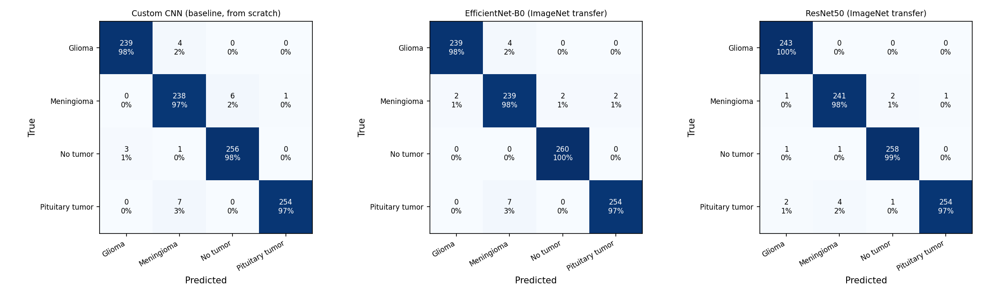
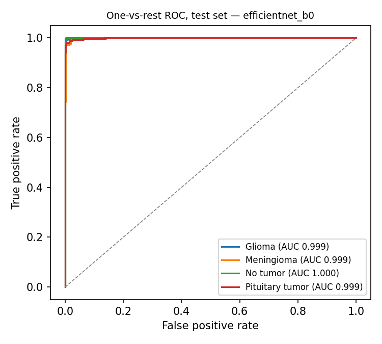
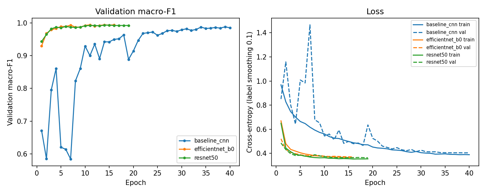
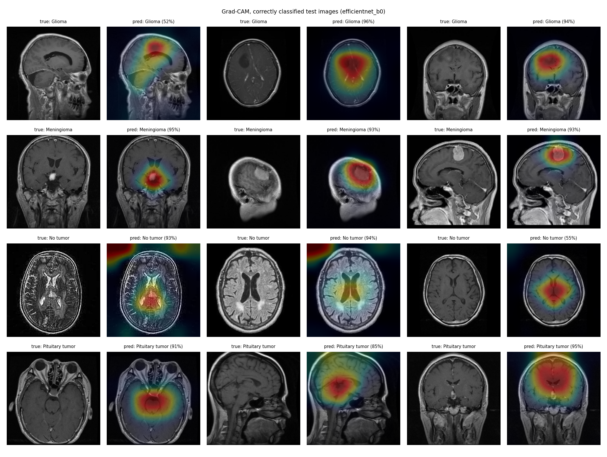
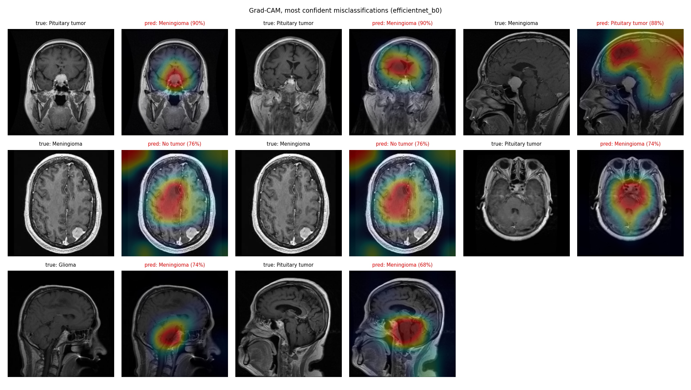

# Evaluation Report — Brain Tumor MRI Classification

Generated by `python -m ml.evaluate` on 2026-09-13. All test numbers come from the held-out test split, which was not used for training, early stopping or model selection.

## 1. Data and split

| Item | Value |
|---|---|
| Raw images (Training + Testing folders) | 7,023 |
| Byte-identical copies removed | 297 |
| Unique images used | 6,726 |
| Near-duplicate groups (dHash ≤ 20/256 bits) | 5,094 groups, largest 44 images |
| Duplicate groups that crossed the original Training/Testing folders | 327 |

Whole duplicate groups are assigned to one split, so no image (or re-encoded / contrast-shifted copy of it) appears in more than one split.

| Split | Images | Share | Glioma | Meningioma | No tumor | Pituitary tumor |
|---|---|---|---|---|---|---|
| train | 4,707 | 70.0% | 1134 | 1144 | 1211 | 1218 |
| val | 1,010 | 15.0% | 243 | 246 | 260 | 261 |
| test | 1,009 | 15.0% | 243 | 245 | 260 | 261 |

## 2. Model comparison (test set, n = 1,009)

95% confidence intervals come from a bootstrap that resamples duplicate groups.

| Model | Params (M) | Best epoch | Val macro-F1 | Test accuracy (95% CI) | Test macro-F1 (95% CI) | Test macro ROC-AUC |
|---|---|---|---|---|---|---|
| Custom CNN (baseline, from scratch) | 2.35 | 39 | 0.9880 | 97.82% (96.69%–98.79%) | 97.81% (96.65%–98.78%) | 0.9989 |
| EfficientNet-B0 (ImageNet transfer) | 4.01 | 11 | 0.9930 | 98.32% (97.32%–99.18%) | 98.30% (97.29%–99.18%) | 0.9993 |
| ResNet50 (ImageNet transfer) | 23.52 | 14 | 0.9930 | 98.71% (97.90%–99.40%) | 98.71% (97.87%–99.40%) | 0.9990 |

**Deployed model: EfficientNet-B0 (ImageNet transfer)** (validation macro-F1 0.9930). Selection used validation data only: models within 0.002 macro-F1 of the best (about 2 validation images) count as tied, and the tie goes to the model with fewer parameters because the app serves predictions on a CPU. Test results were not used for the choice.

## 3. Deployed model — per-class test results

| Class | Precision | Recall | F1 | ROC-AUC | Support |
|---|---|---|---|---|---|
| Glioma | 0.9917 | 0.9835 | 0.9876 | 0.9993 | 243 |
| Meningioma | 0.9560 | 0.9755 | 0.9657 | 0.9988 | 245 |
| No tumor | 0.9924 | 1.0000 | 0.9962 | 1.0000 | 260 |
| Pituitary tumor | 0.9922 | 0.9732 | 0.9826 | 0.9990 | 261 |

## 4. Explainability (Grad-CAM)

The deployed model misclassified 17 of 1,009 test images. Heat-maps below are computed on the final convolutional feature map for the predicted class.

### Qualitative review of the heat-maps

Manual review of the two figures above for model `efficientnet_b0-epoch11` (seeded sample, so the figures are reproducible).

**Where the heat-maps look right**
- Meningiomas with a clearly visible enhancing mass: all three sampled cases put the peak directly on the mass (suprasellar, parietal convexity, and superior convexity lesions).
- Pituitary tumours on axial and sagittal slices: attention sits on the central skull-base / sellar region, where the pituitary gland is.

**Where they are weak or misleading**
- Gliomas: attention is broad and centred on the midline rather than tightly on the lesion (e.g. the axial case with a cystic lesion in the upper-left hemisphere only partly overlaps the hot spot).
- "No tumor" predictions: two of the three sampled heat-maps have hot spots in the image corners, outside the head. The model is partly using image-level cues (framing, background, processing style) instead of anatomy. The data explains why: only about 1% of "no tumor" images are 512 × 512 pixels (254 different sizes), while 85–100% of each tumour class are, so image format alone separates "no tumor" from the rest. This is the most important caveat for real-world use.
- The heat-map comes from a 7 × 7 feature map, so it marks a region, not a tumour outline.

**Errors**
- Most confident errors are pituitary tumour ↔ meningioma confusions for masses near the sella turcica, where the two tumour types genuinely look alike. In some of these the heat-map is on the mass (right place, wrong class); in others it is on unrelated brain tissue.
- A meningioma with a small posterior lesion was called "no tumor" and the heat-map misses the lesion. The same scan appears twice (a contrast-shifted copy in the same duplicate group), so it counts as two test errors.

## 5. Unusual-input detection

A classifier always outputs one of its four classes, even for a photo or a document, often with high confidence. The app therefore also computes an out-of-distribution score (Mahalanobis distance of penultimate features to the nearest class mean (Ledoit-Wolf covariance)). Scores above the threshold (99th percentile of validation-set scores) show an "Unusual input" warning on the report.

| Input | Images | Flagged as unusual | Median model confidence |
|---|---|---|---|
| Real MRI, validation split (sets the threshold) | 1,010 | 1.1% | — |
| Real MRI, test split | 1,009 | 1.1% | — |
| Cartoon head phantoms | 40 | 88% | 83% |
| Random noise | 20 | 100% | 88% |
| Gradients | 10 | 100% | 76% |
| Portrait photo (and crops) | 15 | 100% | 75% |
| Text documents | 10 | 100% | 87% |

On real test scans the flag also marks less reliable predictions: accuracy is 81.8% on the 11 flagged scans versus 98.5% on the rest, so the warning in the app covers both non-MRI uploads and unusual real scans. The check has not been tested on MRI of other body parts or other brain conditions, which it may not flag.

## 6. Application response time

Measured with `python -m ml.benchmark_app` against `http://127.0.0.1:8000` on local laptop (Intel i7-13650HX), CPU inference with onnxruntime: 40 uploads of test-split images.

| Measurement | Mean (ms) | Median (ms) | p95 (ms) |
|---|---|---|---|
| Upload → report page (end to end) | 297 | 301 | 353 |
| `POST /api/predict` round trip | 153 | 151 | 187 |
| Server-side preprocessing + model + heat-map | 96 | 93 | 127 |

## 7. Limitations

- The dataset has no patient identifiers. Grouping by perceptual hash removes duplicates and many adjacent slices of the same scan, but images of the same patient that look different could still fall into different splits.
- A single public dataset was used; there is no external validation on data from another hospital or scanner.
- The "no tumor" images come from different sources than the tumour images: only about 1% of them are 512 × 512 pixels, against 85–100% for each tumour class. Grad-CAM shows the model partly uses such image-level cues (framing, background), so accuracy on scans from a single hospital is likely lower than the test numbers above.
- The baseline CNN was still improving when it reached its 40-epoch limit, so the gap between it and the transfer-learning models may be slightly overstated.
- There are no tumour segmentation masks, so Grad-CAM localisation is reviewed qualitatively, not scored.
- Research prototype for education only — not a medical device, and not for diagnosis.
